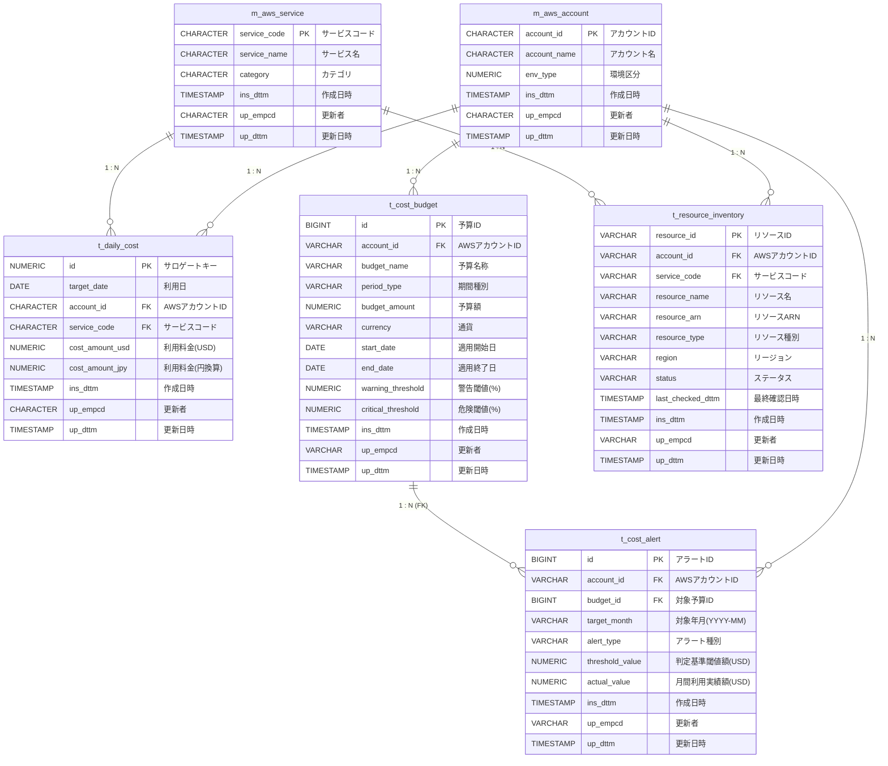

# AWS FinOps & Cost Monitoring Dashboard

[🇯🇵 日本語](#japanese) | [🇺🇸 English](#english)

---

## 日本語

AWS 環境におけるクラウドリソースと利用コストを可視化・管理するための FinOps ダッシュボードアプリケーションです。
**AWS ネイティブ環境（S3, CloudFront, EC2, RDS）** へのフルスタック移行を完了し、本番運用を行っています。

### 📸 スクリーンショット

### 技術スタック
- **フロントエンド:** React, Vite, Recharts (Amazon S3 + CloudFront にて配信)
- **バックエンド:** Java 17, Spring Boot 3, Spring Data JPA (Amazon EC2 にてホスティング)
- **データベース:** PostgreSQL 18 (Amazon RDS - プライベートサブネット配置)
- **DNS・SSL:** Amazon Route 53 + AWS Certificate Manager (ACM)
- **セキュリティ・運用:** AWS Systems Manager (SSM Session Manager), VPC分離設計

### 主な機能
- **コスト可視化:** サービス別のコスト推移と利用割合を直感的にグラフ表示。
- **予算管理:** アカウント・サービスごとの月間予算と警告閾値のモニタリング。
- **アラート検知・対応:** 予算超過の兆候を検知し、ダッシュボードから確認・解消（Resolve）可能。

### ロードマップ
- [x] **v1.0:** フルスタック MVP 開発とホスティング環境（Render / Vercel）での公開
- [x] **v2.0:** AWS ネイティブ環境へのインフラ完全移行 (S3/CloudFront, EC2, RDS, Route 53)
- [ ] **v2.1:** AWS Cost Explorer API を用いたデータ自動連携

### 🔌 画面構成とAPI仕様 (UI to API Mapping)

| UIコンポーネント (画面) | HTTP | APIエンドポイント | 主な取得・更新データ |
| :--- | :--- | :--- | :--- |
| **サービス別 日次コスト** (棒グラフ) / **コスト割合** (円グラフ) | `GET` | `/api/v1/daily-costs` | `serviceCode` (サービス名) `costAmountUsd` (コスト額) |
| **AWSアカウント** (リスト) | `GET` | `/api/v1/accounts` | `accountId` (アカウントID) `accountName` (アカウント名) |
| **月間コスト予算** (リスト) | `GET` | `/api/v1/budgets` | `budgetName` (予算名) `budgetAmount` (予算額) `warningThreshold` (警告閾値) |
| **アラート** (リスト) | `GET` | `/api/v1/alerts?status=OPEN` | `serviceCode` (対象サービス) `actualValue` (実績値) `thresholdValue` (閾値) |
| **確認済みにする** (ボタン) | `PUT` | `/api/v1/alerts/{id}/resolve` | `status` を "RESOLVED" に更新し、未確認一覧から除外 |

### データベース設計（ER図）

---

## English

A cloud cost visualization and FinOps monitoring dashboard application built with **React**, **Spring Boot 3**, and **PostgreSQL**, deployed entirely on **AWS Cloud Infrastructure**.

### Architecture & Tech Stack
- **Frontend**: React (Vite), Recharts — Hosted on **Amazon S3** + **Amazon CloudFront**
- **Backend**: Java 17, Spring Boot 3, Spring Data JPA (Hibernate) — Deployed on **Amazon EC2** (Public Subnet)
- **Database**: PostgreSQL 18 — Hosted on **Amazon RDS** (Isolated in Private Subnet)
- **DNS & SSL**: Amazon Route 53 + AWS Certificate Manager (ACM)
- **Security & Ops**: AWS Systems Manager (SSM Session Manager), VPC network segmentation, environment variables injection for credentials

### Key Features
- **Cost Analytics**: Visualizes daily and monthly AWS usage cost breakdown by service.
- **Budget Monitoring**: Tracks budget thresholds per account/service.
- **Alert Detection & Resolution**: Detects threshold violations and allows in-app alert status resolution.

### Roadmap
- [x] **v1.0:** Full-stack MVP development & deployment on hosting platforms (Render / Vercel)
- [x] **v2.0:** Full infrastructure migration to native AWS (S3/CloudFront, EC2, RDS, Route 53)
- [ ] **v2.1:** Automated cost ingestion via AWS Cost Explorer API

### 🔌 UI to API Mapping

| UI Component | HTTP | Endpoint | Data Handled |
| :--- | :--- | :--- | :--- |
| **Service Daily Costs & Breakdown** | `GET` | `/api/v1/daily-costs` | `serviceCode`, `costAmountUsd` |
| **AWS Accounts List** | `GET` | `/api/v1/accounts` | `accountId`, `accountName` |
| **Monthly Budget** | `GET` | `/api/v1/budgets` | `budgetName`, `budgetAmount`, `warningThreshold` |
| **Alerts (Open)** | `GET` | `/api/v1/alerts?status=OPEN` | `serviceCode`, `actualValue`, `thresholdValue` |
| **Resolve Alert** | `PUT` | `/api/v1/alerts/{id}/resolve` | Updates status to `RESOLVED` |
