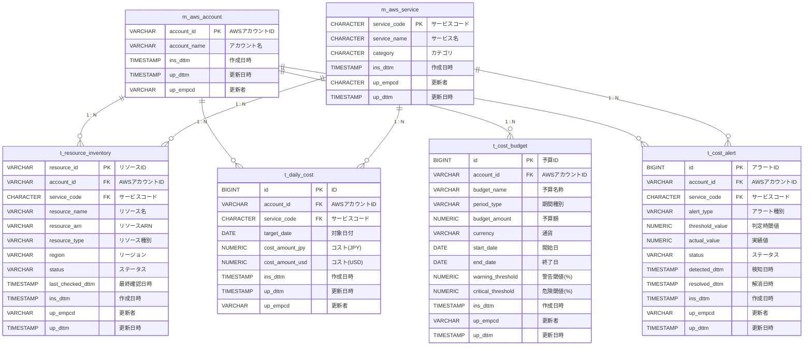

# aws-cost-monitoring-dashboard
AWS Cost and Resource Monitoring Dashboard (Spring Boot 3 / Python / PostgreSQL)
# AWS Cost Monitoring Dashboard (FinOps)

AWS環境のクラウドリソースと利用コストを可視化・管理するためのダッシュボードアプリケーションです。
現在は MVP (v1.0) として、フルスタック環境（React + Spring Boot + PostgreSQL）を構築し、ホスティングサービス上で公開しています。

## 📸 スクリーンショット

## 技術スタック (v1.0)
* **フロントエンド:** React, Vite, Recharts (Vercel にてホスティング)
* **バックエンド:** Java, Spring Boot, JPA (Render にてホスティング)
* **データベース:** PostgreSQL (Render Managed DB)
* **バージョン管理:** Git, GitHub

## 主な機能
* **コスト可視化:** サービス別のコスト一覧と割合をグラフで直感的に表示。
* **予算管理:** アカウントやサービスごとの月間予算と警告閾値のモニタリング。
* **アラート検知:** 予算超過の兆候を検知し、未確認アラートとして画面上に通知。
* **リソースインベントリ:** 稼働中のAWSリソースとステータスを一覧表示。

## ロードマップ
* **[x] v1.0:** フルスタック MVP 開発とホスティング環境での公開
* **[ ] v2.0:** AWS ネイティブ環境へのインフラ移行 (S3/CloudFront, ECS/App Runner, RDS)
* **[ ] v2.1:** AWS Cost Explorer API を用いたデータ取得の自動化
## 🔌 画面構成とAPI仕様 (UI to API Mapping)

フロントエンドの各UIコンポーネントと、バックエンド（Spring Boot）の REST API エンドポイントの連携仕様です。
実務での運用を見据え、コンポーネントごとに必要なデータのみを取得するよう設計しています。

| UIコンポーネント (画面) | HTTP | APIエンドポイント | 主な取得・更新データ |
| :--- | :--- | :--- | :--- |
| **サービス別 日次コスト** (棒グラフ) / **コスト割合** (円グラフ) | `GET` | `/api/v1/daily-costs` | `serviceCode` (サービス名) `costAmountUsd` (コスト額) |
| **AWSアカウント** (リスト) | `GET` | `/api/v1/accounts` | `accountId` (アカウントID) `accountName` (アカウント名) |
| **月間コスト予算** (リスト) | `GET` | `/api/v1/budgets` | `budgetName` (予算名) `budgetAmount` (予算額) `warningThreshold` (警告閾値) |
| **アラート** (リスト) | `GET` | `/api/v1/alerts?status=OPEN` | `serviceCode` (対象サービス) `actualValue` (実績値) `thresholdValue` (閾値) |
| **確認済みにする** (ボタン) | `PUT` | `/api/v1/alerts/{id}/resolve` | `status` を "RESOLVED" に更新し、未確認一覧から除外 |
| **リソース詳細一覧** (テーブル) | `GET` | `/api/v1/resource-inventories` | `resourceName` (リソース名) `serviceCode` (サービス) `region` (リージョン) `status` (ステータス) |

* 
## データベース設計（ER図）
本プロジェクトのデータベースはPostgreSQLを使用し、以下の設計としています。

